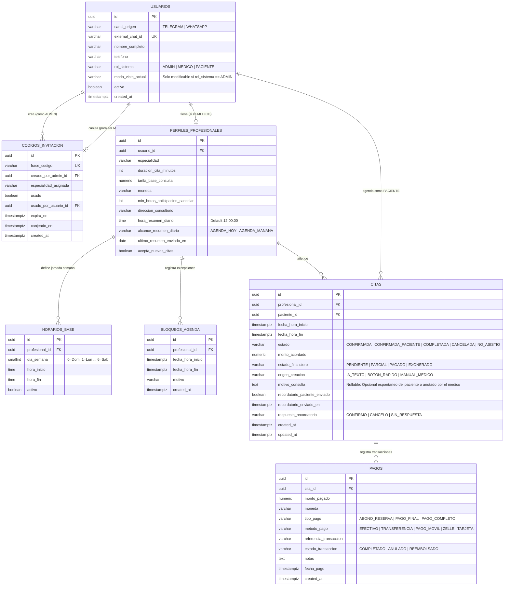

# SPEC.md — Especificación Técnica y Funcional: Asistente Médico de Citas (IA + Híbrido)

## 1. Visión General del Sistema
Sistema automatizado e inteligente de agendamiento médico, control de disponibilidad, recordatorios y seguimiento financiero que opera sobre **Telegram** y **WhatsApp**. 

El sistema utiliza una **Arquitectura Híbrida**:
1. **Ruta Inteligente (LLM + MCP/Tools):** Procesa lenguaje natural libre mediante **Gemini Flash**, filtrando dinámicamente las herramientas disponibles según el rol del usuario autenticado por el **API Gateway**.
2. **Ruta Rápida (Callback / Botones Interactivos):** Procesa confirmaciones, selecciones de horarios y acciones rápidas de forma determinista directamente contra PostgreSQL/Redis en milisegundos, sin consumir cuota ni tokens de IA.

---

## 2. Arquitectura y Flujo de Red

```text
[ Telegram / WhatsApp ]
          │
          ▼ (1. POST /asistente-citas/api/v1/webhook)
[ API Gateway Central (Go 1.24 - api-gateway-auth) ]
  ├── Aplica Rate Limiting por IP en Redis y sanitiza la ruta
  ├── Filtro Anti-Spoofing (elimina X-* no autorizados, permite passthrough de firmas)
  └── Inyecta X-Internal-Api-Key y X-Request-Id (y X-User-* si hay sesión JWT)
          │
          ▼ (2. POST /api/v1/webhook - Red Interna / localhost:8005)
[ Microservicio Asistente Médico (Python 3.11 + FastAPI) ]
  ├── Guardián de Seguridad Modular (src/core/webhook_signature.py + dependencies.py):
  │     ├── Verifica X-Internal-Api-Key del Gateway
  │     ├── Valida firma criptográfica (X-Telegram-Bot-Api-Secret-Token / X-Hub-Signature-256)
  │     └── Resuelve identidad en BD (external_chat_id -> user_id, rol_sistema, modo_vista_actual)
  ├── Semáforo de Entrada:
  │     ├── Si es "callback_query" (Botón) ──► [ Ruta Rápida (SQL directo - 0 tokens) ]
  │     └── Si es "message" (Texto libre)  ──► [ Orquestador Gemini Flash + Servidor MCP ]
  │
  ├── [ Redis ] ──► Historial de chat (TTL 2h), Locks de reserva (TTL 5m) y Worker ARQ
  └── [ PostgreSQL ] ──► Persistencia relacional, agenda por excepción y libro de pagos
```

---

## 3. Contrato con el API Gateway y Seguridad Modular (RBAC / PBAC)

El microservicio **nunca** confía en el contenido del texto del chat para determinar quién es el usuario. Opera detrás de `api-gateway-auth` (Go) bajo un diseño **modular de doble modalidad** que respeta el carácter 100% agnóstico del Gateway (`SPEC_API_GATEWAY_AUTH.md` §4 y §5.1) y permite migrar la validación de firmas a un middleware del Gateway en el futuro sin tocar la lógica de negocio:

### 3.1 Cabeceras de Seguridad y Modos de Resolución
| Cabecera HTTP | Origen | Descripción | Ejemplo |
| :--- | :--- | :--- | :--- |
| `X-Internal-Api-Key` *(o alias `X-Internal-Secret`)* | Inyectada por Gateway | Clave secreta compartida (`api_key` en `MICROSERVICES`) que garantiza que la petición viene del Gateway | `dev-internal-secret-key` |
| `X-Telegram-Bot-Api-Secret-Token` | Passthrough Telegram | Token secreto configurado en `setWebhook` de Telegram (validado con `hmac.compare_digest`) | `tg_secret_123` |
| `X-Hub-Signature-256` | Passthrough WhatsApp | Firma `HMAC-SHA256` (`sha256=<hex>`) del body crudo firmada con `WHATSAPP_APP_SECRET` | `sha256=a8f9...` |
| `X-User-Id` | Opcional (Gateway / Test) | UUID interno del usuario cuando las cabeceras de identidad vienen pre-resueltas | `550e8400-e29b-41d4-a716-446655440000` |
| `X-External-Chat-Id` | Opcional (Gateway / Test) | ID inmutable de Telegram o Teléfono de WhatsApp | `987654321` |
| `X-Channel-Origin` | Opcional (Gateway / Test) | Canal de mensajería de origen (`TELEGRAM` \| `WHATSAPP`) | `TELEGRAM` |
| `X-User-Role` | Opcional (Gateway / Test) | Rol efectivo para la petición (considerando `modo_vista_actual` si es `ADMIN`) | `ADMIN` \| `MEDICO` \| `PACIENTE` |
| `X-User-Permissions` | Opcional (Gateway / Test) | Lista separada por comas de permisos activos | `disponibilidad:consultar,citas:agendar_propia` |

* **Modo A (Passthrough desde `api-gateway-auth` en `public_paths`):** El Gateway verifica Rate Limiting, limpia cabeceras `X-*` no autorizadas, permite el passthrough de `X-Telegram-Bot-Api-Secret-Token` / `X-Hub-Signature-256` e inyecta `X-Internal-Api-Key`. El módulo desacoplado `src/core/webhook_signature.py` valida criptográficamente la firma del proveedor, extrae `(canal_origen, external_chat_id)` del payload y `dependencies.py` resuelve (o registra como `PACIENTE`) al usuario en la tabla `usuarios`, aplicando su `modo_vista_actual` y mapa de permisos RBAC.
* **Modo B (Cabeceras pre-resueltas por Middleware/Tests):** Si el Gateway (o un futuro middleware dedicado) ya inyecta `X-User-Id`, `X-User-Role`, `X-Channel-Origin` y `X-External-Chat-Id`, `dependencies.py` construye el `UserContext` directamente sin sobrecarga adicional.

### 3.2 Jerarquía de Roles
1. **`ADMIN` (Superusuario):** Control total sobre la plataforma. Puede generar frases/códigos de invitación para dar de alta médicos, listar profesionales activos y ver métricas globales. **Es el único rol que puede cambiar de modo de vista** (`/modo_admin`, `/modo_medico`, `/modo_paciente`) para simular y probar los flujos de otros roles.
2. **`MEDICO` (Profesional de la Salud):** Gestiona su propio perfil, configura su horario base semanal, registra bloqueos por imprevistos, consulta su agenda del día/semana, agenda o mueve citas manualmente (pudiendo registrar el motivo de consulta), registra pagos/descuentos y consulta sus ganancias. No puede cambiar su modo de vista.
3. **`PACIENTE` (Usuario Estándar):** Consulta horarios disponibles, agenda citas propias (sin que el bot le exija motivo de consulta, aunque se guarda si lo menciona espontáneamente), consulta sus próximas citas, cancela o reagenda (respetando el tiempo mínimo de anticipación del médico) y confirma asistencia en los recordatorios.

---

## 4. Modelo de Datos en PostgreSQL

### 4.1 Diagrama Entidad-Relación (Mermaid)



### 4.2 Restricciones e Índices Críticos en PostgreSQL
1. **Prevención física de doble agendamiento (Índice Único Parcial):**
   ```sql
   CREATE UNIQUE INDEX idx_cita_unica_activa 
   ON citas (profesional_id, fecha_hora_inicio) 
   WHERE estado NOT IN ('CANCELADA');
   ```
2. **Búsqueda rápida de identidad en el Gateway/Bot:**
   ```sql
   CREATE UNIQUE INDEX idx_usuario_canal_external_id 
   ON usuarios (canal_origen, external_chat_id);
   ```

---

## 5. Estructuras en Redis y Tareas Programadas (`arq`)

Redis cumple tres funciones dentro de la misma instancia:

### 5.1 Claves de Memoria y Concurrencia
| Patrón de Clave | Tipo | TTL | Propósito |
| :--- | :--- | :--- | :--- |
| `chat:history:{user_id}` | `LIST` (JSON) | `7200s` (2 horas) | Almacena los últimos 10 mensajes de la conversación para mantener el contexto con Gemini Flash. |
| `chat:last_prof:{user_id}` | `STRING` (`prof_id`) | `7200s` (2 horas) | Almacena el `profesional_id` del último médico consultado en `consultar_disponibilidad` como referencia de contexto para el turno de agendamiento (`agendar_cita_paciente`). |
| `lock:slot:{prof_id}:{YYYY-MM-DD_HH:MM}` | `STRING` (`user_id`) | `300s` (5 min) | Bloqueo atómico (`SET NX EX 300`) mientras el paciente confirma sus datos para evitar que otro usuario tome la misma hora simultáneamente. |

### 5.2 Trabajos en Segundo Plano (Cron Jobs con `arq`)
1. **Lote Diario de Recordatorios a Pacientes (`12:00 PM` fijo todos los días):**
   * **Trigger:** Se ejecuta todos los días a las `12:00:00`.
   * **Consulta:** Selecciona todas las citas cuya `fecha_hora_inicio` corresponda al día siguiente (`CURRENT_DATE + 1`), con `estado = 'CONFIRMADA'` y `recordatorio_paciente_enviado = false`.
   * **Acción:** Envía el mensaje con botones interactivos `[ Confirmar Asistencia ]` y `[ Cancelar Cita ]`, y marca `recordatorio_paciente_enviado = true`.
2. **Heartbeat Horario de Resumen para Médicos y Cierre de Citas (Cada hora en punto):**
   * **Cierre automático de citas pasadas:** Actualiza a `estado = 'COMPLETADA'` todas las citas cuya `fecha_hora_fin < NOW()` y que sigan en `CONFIRMADA` o `CONFIRMADA_PACIENTE`.
   * **Envío de resumen al médico:** Busca en `PERFILES_PROFESIONALES` aquellos médicos donde `hora_resumen_diario == HORA_ACTUAL` y `(ultimo_resumen_enviado_en IS NULL OR ultimo_resumen_enviado_en < CURRENT_DATE)`.
     * Si `alcance_resumen_diario == 'AGENDA_HOY'`: Envía la lista de pacientes del día en curso.
     * Si `alcance_resumen_diario == 'AGENDA_MANANA'`: Envía la lista de pacientes del día siguiente.
     * Actualiza `ultimo_resumen_enviado_en = CURRENT_DATE`.

---

## 6. Especificación del Flujo Híbrido: Payloads de Botones (`callback_query`)

Para que los clics en botones no pasen por Gemini Flash (0 tokens y respuesta en menos de 50 ms), los botones utilizan un formato compacto separado por tuberías (`|`) con un límite de 64 bytes (requisito de Telegram API):

| Acción del Botón | Formato del Payload (`callback_data`) | Quién lo ejecuta | Acción directa en Backend (Sin IA) |
| :--- | :--- | :--- | :--- |
| **Elegir horario para agendar** | `BOOK\|{prof_short_id}\|{YYYYMMDD_HHMM}` | Paciente | Verifica disponibilidad, inserta la cita en `CITAS` con `origen_creacion = 'BOTON_RAPIDO'` y responde con el resumen. |
| **Confirmar recordatorio (12 PM)** | `R_OK\|{cita_id}` | Paciente | Actualiza `CITAS.estado = 'CONFIRMADA_PACIENTE'` y `respuesta_recordatorio = 'CONFIRMO'`. Notifica al médico. |
| **Cancelar desde recordatorio** | `R_CAN\|{cita_id}` | Paciente | Valida ventana de `min_horas_anticipacion_cancelar`. Si es válido, pasa a `CANCELADA`, libera el horario y alerta al médico. |
| **Marcar cita como pagada (Total)** | `PAY_FULL\|{cita_id}` | Médico | Inserta registro en `PAGOS` por el saldo restante de `monto_acordado` y actualiza `CITAS.estado_financiero = 'PAGADO'`. |
| **Marcar inasistencia** | `NO_SHOW\|{cita_id}` | Médico | Actualiza `CITAS.estado = 'NO_ASISTIO'` y `estado_financiero = 'EXONERADO'`. |

---

## 7. Reglas de Negocio Clave

1. **Ancla Temporal Dinámica:** Antes de cada llamada a Gemini Flash, el backend inyecta en el `System Prompt` la fecha, hora actual y día de la semana (zona horaria configurada) para resolver referencias relativas (*"el próximo lunes"*, *"mañana por la tarde"*).
2. **Motivo de Consulta Opcional y No Intrusivo:** El asistente **nunca** le preguntará al paciente cuál es el motivo de su consulta para poder agendar. El campo `motivo_consulta` quedará `NULL` por defecto, y solo se poblará si el paciente lo expresa voluntariamente en su mensaje o si el médico lo especifica al crear/editar una cita manualmente.
3. **Cálculo de Disponibilidad por Excepción:** Los horarios libres nunca se almacenan vacíos en la base de datos. Se calculan en memoria generando los bloques de `duracion_cita_minutos` a partir de `HORARIOS_BASE` para la fecha solicitada, restando los rangos en `BLOQUEOS_AGENDA`, las filas activas en `CITAS` y los locks temporales activos en Redis.
4. **Onboarding de Médicos por Frase/Código:** Un usuario nuevo entra siempre como `PACIENTE`. Si envía una frase existente en `CODIGOS_INVITACION` que tenga `usado = false` y `expira_en > NOW()`, el sistema actualiza su `rol_sistema = 'MEDICO'`, `modo_vista_actual = 'MEDICO'`, crea su registro en `PERFILES_PROFESIONALES` y marca el código como consumido.
5. **Exclusividad de Cambio de Vista (`ADMIN`):** Únicamente los usuarios con `rol_sistema == 'ADMIN'` pueden modificar su `modo_vista_actual` (`ADMIN`, `MEDICO`, `PACIENTE`). Los usuarios con rol `MEDICO` o `PACIENTE` tienen su vista bloqueada permanentemente a su propio rol.
6. **Cálculo Automático del Estado Financiero:** Cada vez que se inserta o anula una fila en `PAGOS`, o se modifica `CITAS.monto_acordado`, una función transaccional recalcula `SUM(monto_pagado)` de los pagos completados de esa cita:
   * Si `suma == 0` ➔ `PENDIENTE`
   * Si `0 < suma < monto_acordado` ➔ `PARCIAL`
   * Si `suma >= monto_acordado` ➔ `PAGADO`
7. **Catálogo Dinámico de Médicos y Especialidades en Saludo del Paciente:** Cuando un usuario interactúa con rol `PACIENTE` (ya sea registrado previamente o auto-registrado en su primer mensaje), el backend inyecta en el `System Prompt` la lista actualizada de médicos activos (`acepta_nuevas_citas = true` y `usuario.activo = true`) con su especialidad y tarifa base, instruyendo al asistente a presentar las especialidades y profesionales disponibles cuando el paciente saluda o solicita información general.